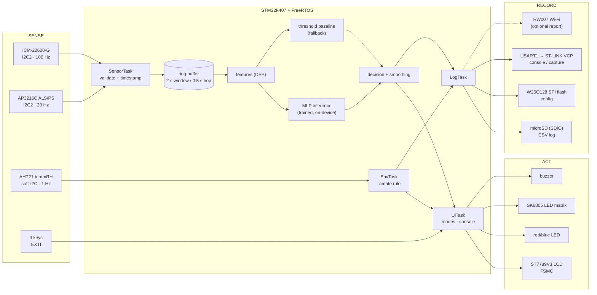

# PackSense: design document

**Edge-AI smart backpack insert on the RT-Thread RT-Spark (STM32F407ZGT6)**
BCA182 Embedded Systems Programming, Laboratory Activity No. 4, MSU-IIT CCS

Team: Sherie Grace L. Lupoz · Renato G. Beroy · Binyusoph P. Sansarona
Status: **draft for concept approval** (M0). The full requirements are in [`../PRD.md`](../PRD.md).

---

## 1. Problem statement

Students and commuters carry laptops, tablets and power banks in backpacks every
day. They get no feedback when the bag is handled roughly (set down hard, thrown
onto a jeepney seat, swung). They also get none when a sleeping laptop overheats
or traps humidity inside a closed bag, or when someone opens the bag while it is
unattended (on a library chair or a classroom hook). **PackSense** is a small
insert that sits in the laptop compartment. It senses motion, light/proximity and
the bag's internal climate, and it classifies what is happening to the bag **on
the device**. It alerts the owner locally through the LCD, LEDs, LED matrix and
buzzer, and it keeps a timestamped event log for later review. It works fully
offline. Wi-Fi is only an optional extra for event reporting.

- **User:** university students and commuters who carry electronics in backpacks.
- **Environment:** inside a backpack. Indoor and outdoor, 20–45 °C, dark when closed, irregular motion.
- **Goal:** tell the owner promptly, without a phone or a network, about rough handling, unattended access, and heat/humidity risk.

## 2. Alternatives considered

| Alternative | Why not chosen |
|---|---|
| Context-aware study desk (studying / phone-fidgeting / away) | Studying vs. fidgeting is hard to label objectively, and an IMU on a stationary desk separates them poorly, so the model would likely be weak |
| Smart medicine/storage box (opened / taken / idle) | Only about 2 natural classes, and it mostly reduces to a light threshold, so ML adds little over the baseline |
| **PackSense backpack insert (chosen)** | Clear user, and the classes are physically distinct and safe to reproduce. It fuses IMU + light/proximity (+ climate context), so a trained model has a fair chance to beat a threshold baseline |

## 3. Classification states

| ID | Label | Definition (for labeling) | Safe reproduction |
|---|---|---|---|
| 0 | `STILL` | Bag at rest on a floor, desk or chair, closed and untouched | Leave the bag on a surface |
| 1 | `CARRIED` | Bag worn, or held by the handle, while the carrier walks normally | Walk a corridor at normal pace |
| 2 | `ROUGH` | Abrupt handling: set down hard, swung, shaken, tossed onto a soft seat | Firm set-down, or a toss onto a cushion/bed from ≤ 50 cm, **with a dummy load only, never a laptop** |
| 3 | `ACCESS` | Bag opened and a hand inserted or contents rummaged | Open the compartment, reach in, move items, close |

**Model inputs:** ICM-20608-G IMU and AP3216C ambient light + proximity. These are the two
primary sensing modalities. The temp/RH sensor (AHT21 on the HW1.1 schematic) is
**context only**. It drives a rule-based climate warning and is not a classifier
feature.

## 4. Product behaviour

| Situation | Response |
|---|---|
| `ROUGH` detected | Buzzer chirp + amber cue (red+blue LED pattern / LED-matrix amber) + LCD "Rough handling detected", logged |
| `ACCESS` while **GUARD** armed | Alarm pattern, red LED, LED-matrix flash. Silenced by a button acknowledge |
| `ACCESS` while unarmed | Logged only |
| Temperature > threshold (start at 40 °C; final value from measurements) or RH > 80 % for N min | "Bag too hot/humid, check laptop" warning |
| Home screen | Current state + confidence, the "why" values (motion energy, light, proximity), guard state, climate |

The board has red and blue indicator LEDs only (see `hardware/pinmap.md`). It has no
green LED wired to the MCU, so the "amber" and "OK" colours use the 19-pixel
SK6805 RGB LED matrix, and the LCD text always backs them up.

## 5. Block diagram

## 6. Operating modes

| Mode | Entered by | Behaviour |
|---|---|---|
| `BOOT_SELFTEST` | power-on | Init every peripheral, record pass/fail per component, show summary 2 s |
| `RUN` (default) | after self-test | Classify, alert, log |
| `GUARD` | long-press a key in RUN (exact key in M5) | As RUN, but `ACCESS` raises the alarm |
| `CAPTURE` | key combo at boot or console `mode capture` | Stream raw timestamped CSV over UART (and to SD) with label/session. Keys cycle the label and start/stop trials |
| `DIAG` (service) | key or console `mode diag` | Live readings of every module, output self-tests, RTC, SD/flash test, Wi-Fi status, IR loopback, codec ID, task table (HWM, heap, CPU %), inference stats |

DIAG makes **every** verified module reachable from the single firmware. That
includes modules the product does not need: IR TX/RX, the ES8388 codec, CAN/RS485
(connector status only).

## 7. Component-to-function matrix

The full matrix, with pins and verification columns, is in
[`hardware/inventory.md`](hardware/inventory.md). In summary:

| Function | Components |
|---|---|
| Primary sensing (ML) | ICM-20608-G IMU, AP3216C ALS + proximity |
| Context sensing (rule) | AHT21 temperature / humidity |
| User input | 4 arrow keys (ack, guard arm/disarm, mute, mode, capture labels) |
| Local output | ST7789V3 LCD, red/blue LED, SK6805 LED matrix, buzzer |
| Logging / config | RTC (LSE), microSD, W25Q128 SPI flash |
| Communication (optional) | RW007 Wi-Fi; USART1 VCP console |
| Diagnostics only | IR TX/RX loopback, ES8388 codec (no audio stored), CAN/RS485/PMOD connector status |

## 8. Acceptance criteria

| ID | Criterion | Measurement |
|---|---|---|
| AC-1 | Held-out macro-F1 ≥ 0.85 and no class recall < 0.75 (targets; real numbers reported even if missed) | `ml/evaluate.py` on held-out sessions |
| AC-2 | Trained model beats the threshold baseline on macro-F1 | Same split, same windows |
| AC-3 | On-device prediction matches the host model on ≥ 98 % of golden vectors | `selftest model` parity log |
| AC-4 | Median and p95 inference time from ≥ 50 runs; sense-to-feedback < 500 ms after window close | DWT cycle-counter logs |
| AC-5 | Button press → visible/audible response < 150 ms | GPIO timestamp log |
| AC-6 | 15-min soak: 0 crashes/hangs/watchdog resets; missed reads counted | soak log + `tools/analyze_soak.py` |
| AC-7 | ≥ 5 min offline with inference and feedback unchanged | log + video |
| AC-8 | Controlled failure (sensor NACK, SD absent, Wi-Fi loss) → fault shown, bad data rejected, no crash | test log |
| AC-9 | Flash < 70 %, RAM < 80 %, no task stack HWM < 64 words | PlatformIO size report + `diag mem` |

All results are `TODO(measure)` until a script produces them from real logs in `evidence/`.

**Errors that matter.** A missed `ACCESS` while guarded is the worst error (false
negative). A false `ROUGH`/`ACCESS` alarm annoys users and makes them switch the
device off (false positive). `CARRIED` mislabelled as `ROUGH` is the most likely
confusion.

## 9. Privacy, safety, accessibility

- **Privacy:** logs hold only state, confidence, sensor summaries and time, never
  audio or images. The onboard microphone is used only for a DIAG level meter
  that stores no samples. Participants in data collection are coded P1, P2… and
  never named in the repo.
- **Safety:** moderate buzzer use. `ROUGH` data uses a dummy load and soft
  surfaces only. Climate tests use hand warmth or breath, never heat guns. This is an
  experimental prototype, not a certified security or impact-protection device.
- **Accessibility:** every alert is both audible and visual (LED/matrix + LCD
  text), uses a large LCD font, and the buzzer can be muted with a key.

## 10. Hardware findings from the schematic review (affect later milestones)

1. Temp/RH sensor is **AHT21** on the schematic (the PRD says AHT10). The driver will handle both. H to read the chip marking.
2. LCD is **ST7789V3, 240×240, FSMC 8-bit** (NE3 / A18).
3. Only **red and blue** indicator LEDs are wired; the **SK6805 LED matrix** supplies other colours.
4. The **buzzer is active** (on/off GPIO), so it plays patterns, not tones.
5. **ES8388 codec + mic** exists. It is integrated in DIAG only (privacy).
6. **SPI2 is shared** by the W25Q128 flash and RW007 Wi-Fi, so it needs a bus mutex.
7. The AHT sensor is on a **separate bit-banged I2C bus (PE0/PE1)**, so `EnvTask` does not contend with the 100 Hz IMU on I2C2.
8. **PA7** is shared by LED-matrix data and PMOD1 MOSI, and **PB3/PA15** are shared by SWO/JTDI and I2S3. Do not attach PMOD modules, and do not use SWO trace while the codec is active.

## 11. Open items

- [ ] Instructor sign-off on the concept and the `ROUGH` simulation method (PRD §15.4).
- [ ] Physical inventory of fitted modules (`hardware/inventory.md`).
- [ ] Submission deadline (PRD §15.6), for milestone planning.
