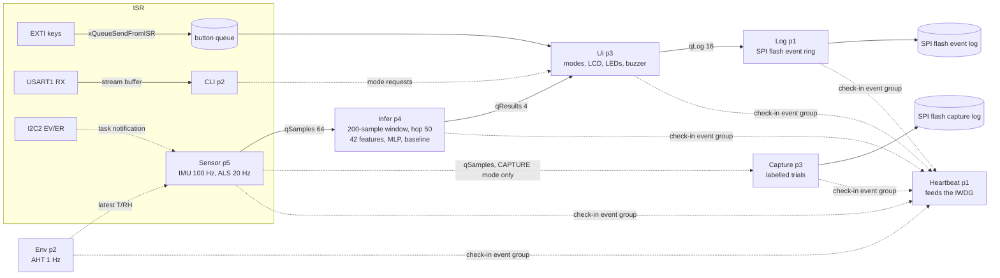

# PackSense: an edge-AI smart backpack insert on the RT-Spark

**BCA182 Embedded Systems Programming, Laboratory Activity No. 4**
"Design and Development of an Edge AI Consumer Product", MSU-IIT CCS.
Group: Sherie Grace L. Lupoz, Renato G. Beroy, Binyusoph P. Sansarona.

> **Draft (M7).** Sections that depend on the recorded data and the M6 tests
> say `TODO(measure)`. They are filled in only from scripts run on files in
> `data/` and `evidence/` (PRD §0.3). Repository:
> <https://github.com/Atoyyyyyy/bca182-lab4-packsense>.

## 1. Problem and design

### 1.1 Problem

Students and commuters carry laptops, tablets and power banks in backpacks
every day. They get no feedback when the bag is handled roughly (dropped,
thrown onto a seat, swung), when a sleeping laptop heats up or humidity builds
up inside a closed bag, or when someone opens the bag while it is unattended
(on a library chair or a classroom hook). PackSense is a small insert for the
laptop compartment. It senses motion, light/proximity and the bag's climate,
classifies what is happening to the bag **on the microcontroller**, alerts the
owner with the LCD, LEDs and buzzer, and keeps a timestamped event log. It
needs no phone and no network.

### 1.2 Alternatives considered

| Alternative | Why not chosen |
|---|---|
| Context-aware study desk (studying / phone-fidgeting / away) | The classes are hard to label objectively and hard to separate with IMU data from a desk that does not move: a weak model is likely |
| Smart medicine / storage box (opened / taken / idle) | About two natural classes; mostly a light threshold, so a model adds little over the baseline |
| **PackSense backpack insert (chosen)** | Clear user; physically distinct classes that are safe to reproduce; uses IMU + light/proximity together, so a model has a fair chance to beat a threshold rule |

### 1.3 States and product behaviour

| State | Definition | Device response |
|---|---|---|
| `STILL` | bag at rest on a surface, closed, untouched | state shown |
| `CARRIED` | worn on the back or held by the handle while walking | state shown |
| `ROUGH` | set down hard, swung, shaken, tossed | chirp, orange banner "Rough handling detected", orange LED matrix, logged |
| `ACCESS` | bag opened, hand inside, contents moved | logged; **in GUARD mode**: alarm sound, red flashing screen, red LED, until any key is pressed |

The AHT21 temperature/humidity sensor is context only (not a classifier
input): above 40 °C or 80 % RH for 30 s the device warns "Bag too hot/humid".
The home screen shows the state, its confidence and the "why" values (motion
spread, jerk, light, proximity, tilt), the GUARD state and the climate.

### 1.4 Acceptance criteria

| ID | Criterion | Result |
|---|---|---|
| AC-1 | Held-out macro-F1 ≥ 0.85, no class recall < 0.75 | TODO(measure): `ml/evaluate.py` |
| AC-2 | Model beats the threshold baseline on macro-F1 | TODO(measure): `ml/evaluate.py`, T1 |
| AC-3 | On-device argmax matches the PC model on ≥ 98 % of 50 golden windows | TODO(measure): `evidence/m5_parity.log` |
| AC-4 | Median and p95 inference time from ≥ 50 runs; window close → feedback < 500 ms | TODO(measure): T2 |
| AC-5 | Key press → visible/audible response < 150 ms | TODO(measure): T7 |
| AC-6 | 15-min soak, 0 crashes / hangs / watchdog resets; missed reads counted | TODO(measure): T4 |
| AC-7 | ≥ 5 min with Wi-Fi off, inference and feedback unchanged | TODO(measure): T5 |
| AC-8 | Sensor NACK / SD absent / Wi-Fi loss → fault shown, invalid data rejected, no crash | TODO(measure): T6 |
| AC-9 | Flash < 70 %, RAM < 80 %, no task stack HWM < 64 words | TODO(measure): T3 |

## 2. Hardware: verified inventory

Board: RT-Thread RT-Spark, STM32F407ZGT6 (168 MHz Cortex-M4F, 1 MB Flash,
128 KB SRAM + 64 KB CCM RAM), PCB marked HW V1.1 (photo
`evidence/m0_board_back.jpg`), so the HW1.1 schematic applies. Every pin and
bus below is cited to that schematic in `docs/hardware/pinmap.md`; nothing
was taken from a generic STM32F407 board.

| Component | Bus | Role | Verified on the board (evidence) |
|---|---|---|---|
| ICM-20608-G IMU | I2C2 `0x68` | primary sensing | WHO_AM_I `0xAF`; 1000/1000 samples at 100.01 Hz, 0 errors (`m2_imu.log`) |
| AP3216C light + proximity | I2C2 `0x1E` | primary sensing | hand over the sensor: ~23 → 0.00 lux, PS → 1023 (`m2_als.log`) |
| AHT21 temperature / RH | software I2C `0x38` | context (climate rule) | AHT2x by CRC; breath: 67.3 → 74.1 % RH (`m2_env.log`) |
| ST7789V3 240×240 LCD | FSMC 8-bit | UI | ID `81 81 B3`, bus test 6/6, 59.11 Hz TE, full frame 13.39 ms (`m2_lcd.log`) |
| Red/blue LED, 19-LED SK6805 matrix, buzzer | GPIO, PA7 (TIM3 DMA), PB0 | outputs | operator checks all yes (`m2_leds/matrix/buzzer.log`) |
| Four arrow keys | EXTI PC0/1/4/5 | input | labels match pins, long press, debounce, 0 dropped (`m2_keys.log`) |
| RTC + 32.768 kHz LSE | internal | timestamps | keeps time through RESET, +80.1 ppm vs HSE (`m2_rtc.log`); no coin cell |
| SPI flash | SPI2 | event log, capture log | JEDEC `EF 40 17`, **8 MiB** (schematic says W25Q128 16 MB), write test 0 errors (`m2_storage.log`) |
| IR LED + receiver | TIM8, PF8 | diagnostics | optical loopback 20/20 and 64/64, dry control 0/20 (`m2_ir.log`) |
| ES8388 codec | I2C2 `0x10` | diagnostics (no audio) | 53 registers, write/read-back 4/4 (`m2_codec.log`) |
| RW007 Wi-Fi | SPI2 | optional, off in the product | TODO(measure): `evidence/m2_wifi.log` |
| microSD slot | SDIO | — | **no card in the kit**: `NOT_PRESENT`, handled (`docs/hardware/exceptions.md` #1) |

Full table with the evidence links: `docs/hardware/inventory.md`.

## 3. System architecture

### 3.1 Tasks and communication

Eight application tasks, all with static stacks in CCM RAM; the I2C2 bus and
the SPI2 bus (flash + RW007) are each protected by a mutex; buzzer patterns
run on a software timer; sampling uses `xTaskDelayUntil`. The task table with
priorities, stacks, periods and measured high-water marks is in
`docs/task_table.md` (HWM: TODO(measure) from the M6 soak).

### 3.2 FreeRTOS integration and reliability

- FreeRTOS V11.1.0 (vendored), 1 kHz tick, heap_4 40 KB, stack overflow check
  method 2, malloc-failed hook, run-time stats; SysTick, PendSV and SVC belong
  to FreeRTOS only and the HAL time base moved to TIM6. Every ISR that calls a
  `...FromISR` API has priority ≥ 5 (`configLIBRARY_MAX_SYSCALL_INTERRUPT_PRIORITY`).
- Clock: 8 MHz HSE → PLL → 168 MHz, read back from RCC at boot; the FreeRTOS
  tick runs at 999.93 ticks per PC second over 190 s (`m1_boot.log`,
  `tools/check_heartbeat.py`).
- Watchdog: the IWDG (4 s) is fed only when all seven monitored tasks checked
  in within a 2 s window; a missing task is named and logged after the reset.
- Sensor faults (PRD §6.4): a sample is rejected on a read error, saturation,
  IR overflow or a timestamp gap; a window with > 5 % bad samples is not
  classified; after 3 failures a sensor goes DEGRADED and is re-initialised
  every 5 s without blocking other tasks.

### 3.3 Operating modes

BOOT_SELFTEST (every part reported OK / absent / FAIL on the LCD and console)
→ RUN; LEFT held ~1 s toggles GUARD; UP opens the five DIAG pages (sensors,
tasks, inference, system, I/O test); holding UP at reset enters CAPTURE for
recording data. Every verified module is reachable from this one firmware.

## 4. Dataset

Recorded on this board in CAPTURE mode, with the board in the bag on a power
bank, labelled trials stored in the SPI flash and downloaded with
`tools/capture.py` (protocol: `data/README.md`, `docs/test_sheets/m3_capture.md`).

| Item | Value |
|---|---|
| Signals | ax, ay, az (m/s²), gx, gy, gz (°/s) at 100 Hz; lux and proximity at 20 Hz; T/RH at 1 Hz (context only) |
| Sessions | TODO(measure): from `data/manifest.csv` |
| Variation covered | TODO(measure): bags, carriers, loads, rooms, surfaces |
| Windows per class and split | TODO(measure): `ml/prepare.py` cleaning report |
| Split | by session (`ml/split.yaml`), so no trial gives windows to both train and test |
| Excluded data | TODO(measure): trials and windows removed, with reasons |

## 5. Features, baseline and model

- **Windows:** 2.0 s (200 samples), hop 0.5 s; 1 s trimmed from each end of a trial.
- **Features (42, identical in `ml/features.py` and `src/dsp/features.c`):**
  for |a| and |g|: mean, std, min, max, range, RMS, mean-crossing rate (14);
  for each of ax, ay, az, gx, gy, gz: mean, std, range (18); |a| jerk peak,
  upward crossings of 1.5 g, low-band (gait, bins 2–7) and high-band
  (bins 13–128) energy of |a| from a 256-point DFT, tilt change of the gravity
  vector between the first and last 0.5 s (5); light: mean, range and change
  of log-lux; proximity: maximum and fraction of samples "near" (5).
  Z-scored with the training-set mean and standard deviation.
- **Baseline (required):** four thresholds, tuned on the training windows only
  (coordinate search, macro-F1): std|a| < τ1 → STILL; else jerk peak > τ2 →
  ROUGH; else light range > τ3 or near fraction > τ4 → ACCESS; else CARRIED.
  The same rules run on the MCU (`src/app/baseline.c`).
- **Model:** MLP 42 → 24 → 16 → 4 (ReLU, softmax), scikit-learn, L2
  regularisation chosen by GroupKFold cross-validation over the training
  sessions only (a shallow decision tree is trained the same way for comparison), exported
  as float32 C arrays (`ml/export_c.py` → `src/model/`); about 100 lines of C
  inference, no runtime library.
- **Decision:** majority of the last three windows; confidence below 0.5 is
  shown as uncertain (`?`) and never raises an alert.
- **Parity:** 50 held-out windows with their features and probabilities are
  compiled into the firmware (`test/golden/golden_vectors.h`);
  `selftest model` recomputes them on the MCU (AC-3).
- **Footprint:** TODO(measure): weights (bytes), scratch RAM, from the build.

## 6. Results

### 6.1 Model on the held-out session (PC)

TODO(measure): from `ml/reports/`: confusion matrix, per-class precision /
recall / F1, macro-F1 for the model and the baseline on the same windows,
the misclassified-window list.

### 6.2 On the device (M5, M6)

| Test | Result |
|---|---|
| AC-3 parity | TODO(measure) |
| T1 per-class accuracy, 20 new trials per class (model vs baseline) | TODO(measure) |
| T2 features / MLP time, window close → feedback (median, p95) | TODO(measure) |
| T3 Flash / SRAM / CCM use, lowest task HWM | TODO(measure) |
| T4 15-min soak: resets, watchdog, rejected windows, false alerts | TODO(measure) |
| T5 offline 5 min vs online | TODO(measure) |
| T6 controlled failures (a)–(e) | TODO(measure) |
| T7 key actions 10/10, response times | TODO(measure) |
| T8 DIAG walk | TODO(measure) |

Test procedures and scoring rules: `docs/test_plan.md`.

## 7. Limitations

- One board, one kit: no microSD card (the event log uses the SPI flash);
  no RTC coin cell (time is lost at power-off, so event times fall back to
  uptime until the RTC is set).
- The SPI flash is 8 MiB, not the 16 MB in the schematic BOM.
- Data comes from the team only (operators P1–P3) and a small number of bags
  and rooms; TODO(measure) exact counts.
- System tests were run with a USB tether to log the console, which leaves
  the zipper slightly open; no stairs or vehicles were tested.
- Sensor failures were simulated in the driver (the sensors are soldered on).
- PackSense is an experimental prototype, not a certified security,
  anti-theft or impact-protection device.

## 8. Improvements supported by the test data

At least two, each tied to a number from the logs. TODO(measure) after M6.

## 9. Privacy, safety and accessibility

Summary of `docs/test_sheets/T9_checklist.md` (TODO (H): checked and signed):
no audio or images are recorded; the event log holds states, times and the
bag's T/RH only; data files use operator codes, never names; nearby Wi-Fi
network names are never logged; nothing is sent over a network. Rough-handling
trials use a dummy load only. Every alert is both audible and visible, the
buzzer can be muted while visual alerts remain, the state is written as a
large word (not only a colour), and toggles need a ~1 s hold.

## 10. Reproducibility: tools and versions

| Item | Version |
|---|---|
| PlatformIO platform | `ststm32@20.0.0`, framework `stm32cube` (`framework-stm32cubef4` 1.28.3, HAL v1.8.5) |
| Compiler | GNU Arm Embedded 7-2017-q4-major, arm-none-eabi-gcc 7.2.1, `-O2`, hard-float FPv4-SP |
| RTOS | FreeRTOS-Kernel V11.1.0 (vendored, unmodified) |
| Python / ML | Python 3.13, numpy 2.5.5, scikit-learn 1.9.1, PyYAML 6.0.4, matplotlib 3.11.2 (`ml/requirements.txt`) |
| Model | TODO(measure): version hash printed by `infer` / `selftest model` |
| Firmware | git revision in the boot banner of every evidence log |

Build and flash: `README.md` (*Getting started*). Third-party licenses:
`NOTICE.md`.

## 11. References

1. RT-Thread, *RT-Spark (星火1号) schematic HW1.1, user manual V1.1.0* (sources in `docs/hardware/SOURCES.md`).
2. STMicroelectronics, *RM0090 Reference manual, STM32F405/415, STM32F407/417…*, and the STM32F407ZG datasheet.
3. TDK InvenSense, *ICM-20608-G datasheet*; LITE-ON, *AP3216C datasheet*; Aosong, *AHT10/AHT21 datasheet*.
4. FreeRTOS, *FreeRTOS-Kernel V11.1.0* and the Cortex-M4F port documentation.
5. F. Pedregosa et al., "Scikit-learn: Machine Learning in Python", *JMLR* 12, 2011.
6. BCA182 Laboratory Activity No. 4 handout, MSU-IIT CCS.

## 12. Contributions

TODO (H): who did what (also in `README.md`); every member must be able to
explain the firmware, the model, the hardware roles and the results.
